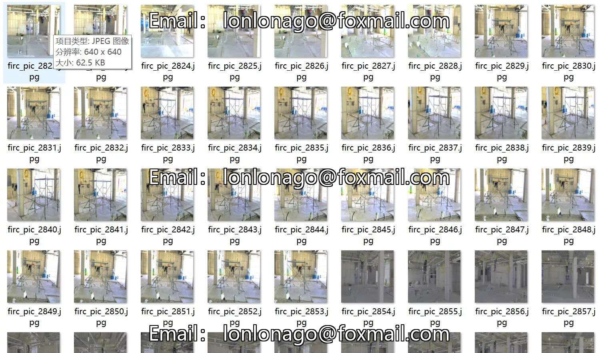

# Mobile scaffolding safety status and worker protection detection dataset VOC+YOLO format

## Body

Mobile scaffolding safety status and worker protection detection dataset VOC+YOLO format with 2919 images in 5 categories
Tips: Due to the dataset's replicability, please confirm compliance before purchasing.
Dataset format: Pascal VOC format + YOLO format (txt file without split path, only containing jpg images along with corresponding VOC format xml files and yolo format txt files)
Number of images (number of jpg files): 2919
Number of annotations (number of xml files): 2919
Number of annotations (number of txt files): 2919
Number of annotation categories: 5

Annotation categories (Note that the order of yolo format categories does not correspond to this, but is based on the classes.txt in the labels folder): ["missing_guardrail", "scaffold_no_outtrigger", "scaffold_outtrigger", "worker_helmet", "worker_no_helmet"]
The number of bounding boxes and the number of images occupied by each category:
- missing_guardrail (Missing guardrail) = 219, occupied images = 218

Scaffold_no_outtrigger (462 frames, 453 images)
Scaffold_outtrigger (938 frames, 928 images)
Worker_helmet (2193 frames, 1688 images)
Worker_no_helmet (1549 frames, 1007 images)
Total frames: 5361
Image resolution: 640x640
Labeling tool used: labelImg

Annotation rules: Draw a rectangle around the category.
Important Notice: The dataset does not have separate training, validation, and test sets; you need to partition them yourself.
Special : This dataset does not guarantee the accuracy of the trained models or weight files.

## Images

## Payment

Here is a pay link on Stripe ( https://buy.stripe.com/3cs8yP7sY87d0vu9AB ). Please contact me lonlonago@foxmail.com after funding $89, and I will send you a complete data files , thank you!

